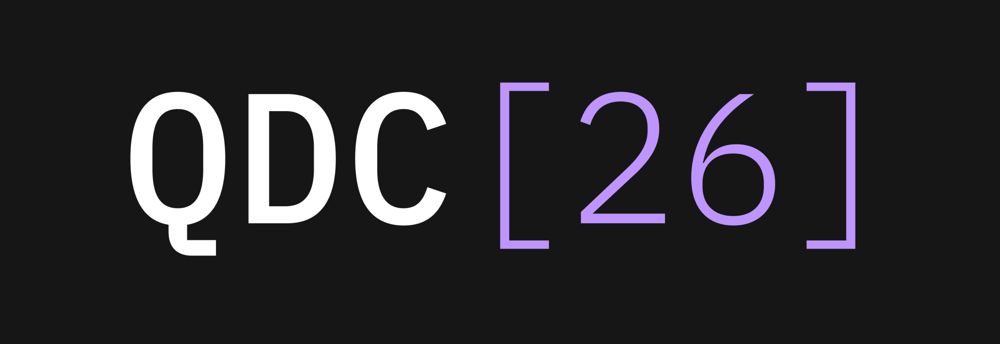

# IBM Quantum Developer Conference 2026



Welcome to the IBM Quantum Developer Conference 2026! These challenges are designed to test your quantum computing skills using the Qiskit product features announced during QDC. The competition spans three days and features two challenge tracks.


## Conference Agenda

### Tuesday 11/10
- 6:00-8:00 PM Welcome Reception

### Wednesday 11/11
- 8:00-9:00 AM Check In & Light Breakfast
- 9:00-10:00 AM IBM Quantum State of the Union
- 10:00-11 AM Application Research Tools -- Utility Mappers and IBM Quantum Functions Beta
- 11:00-11:30 AM Break
- 11:30 AM-12:30 PM Quantum Advantage Roundtable
- 12:30-1:30 PM Lunch
- 1:30-2:30 PM What's New in Qiskit
- 2:30-3:30 PM Progress in QEC -- The Continuous Path to Error Correction
- 3:30-4:00 PM Break
- 4:00-4:30 PM Introducing Challenges
- 4:30-7:00 PM Exhibit Hall: Poster showcase, Partner Demos, Lightning Talks, and Networking; Challenges: Challenge Team Meetings & Office Hours

### Thursday 11/12
- 8:00-9:00 AM Check In & Light Breakfast
- 9:00-10:00 AM Progress in Quantum Algorithms and Applications
- 10:00-11:00 AM Invited Talks: Hamiltonian Simulation; Invited Talks: Optimization
- 11:00-11:30 AM Break
- 11:30 AM-12:30 PM Invited Talks: Hamiltonian Simulation; Invited Talks: Optimization
- 12:30-1:30 PM Lunch
- 1:30-6:00 PM Challenges: Challenge Team Meetings & Office Hours; Exhibit Hall: Poster showcase, Partner Demos, Lightning Talks, and Networking
- 6:00-8:00 PM Dinner & Entertainment

### Friday 11/13
- 8:00-9:00 AM Check In & Light Breakfast
- 9:00-10:00 AM Seminar: Profiling and Performance Tools
- 10:00-11:00 AM Tutorial: Performance metrics and profiling tools in applied workflows
- 11:00-11:30 AM Break
- 11:30 AM-12:30 PM Community contributions to Qiskit; Quantum-Centric Supercomputing; What new in IBM Quantum Learning: Platform Updates and Classroom Accounts
- 12:30-1:30 PM Lunch
- 1:30-4:00 PM Tutorials: (T1) Onset of Ergodicity Across Scales on a Digital Quantum Processor & (T2) Error-detected preparation of the $W$ state with dynamic circuits; Tutorials: (T1) Qiskit Fermions & (T2) Optimization Mapper
- 4:00-4:30 PM Break
- 4:30-5:30 PM Closing Remarks: Awards, Winner Talks, and QDC[26] Wrap-up
- 5:30-7:00 PM Closing Reception


## Installation and Setup

To participate, please complete the setup instructions outlined in the [INSTALL.md](./INSTALL.md) file of this repository before the challenges begin. Remember to bring a laptop with internet access, as no devices will be provided at the venue.

To get your IBM Quantum _access credentials_ and join your team at the event, use the following steps:
1. Meet your team (assigned at check-in).
2. Join the [Qiskit Slack](https://qisk.it/join-slack) and the QDC 2026 challenges channel (**channel TBD**).
3. Retrieve your team access credentials (**contact TBD**).
4. Set `TEAM_NAME` in the team cell of each challenge notebook. Every member of a team uses the same name, and submissions are only graded for a team.


## Challenge Rules

For more information on the contest rules for completing the challenges, read through the [`contest_rules.md`](./contest_rules.md) file of this repository.

## Challenge Notebooks

Throughout QDC, attendees will have the opportunity to participate in hands-on coding challenges inspired by recent, impactful results from the quantum computing community.

These challenges are designed to help you practice using the latest tools and features highlighted in the seminars. There is no single path to the right solution, so participants are encouraged to think creatively and explore different approaches to extract maximum performance from the hardware and software tools. The challenge creators, Qiskit developers, and members of IBM’s Quantum Algorithm Engineering team will be available throughout the event to offer guidance and discuss ideas.

You’ll work in Jupyter notebooks, which are available in this dedicated GitHub repository. To ensure the best possible experience, please complete the [Installation and Setup](#installation-and-setup) steps above before the event.

Each day will include dedicated time to work on challenges. Your team will be assigned to one of two tracks, each covering a diverse range of application domains to accommodate different skills and interests. Leaderboards will display team scores for each challenge in real time. At the end of the event, awards will be given on a per-track basis—the team with the highest overall score across all challenges in each track will win.

Participants will have until Friday, November 13, at 13:00 ET to submit their solutions. Winners will be announced during the award ceremony at 16:00 on the same day.

The challenge notebooks can be found in their respective Track folders. See below for a summary of the topics covered by each challenge:

### [Track A](./challenges/Track_A) (Location TBD)
- Quantum dynamics: [Resolve Prethermal Floquet Structure](./challenges/Track_A/floquet-dynamics/floquet_challenge.ipynb)
- System properties: [Proteasome Challenge: A Guided Laboratory in Molecular Electronic Structure](./challenges/Track_A/proteasome-inhibitor/proteasome_challenge.ipynb)
- Optimization: [Trade Circuits for Shots](./challenges/Track_A/fourier-LCU-QAOA/fourier_LCU_QAOA_challenge.ipynb)
- QEC methods: [Sampling Hard Circuits with Verifiably High Fidelity](./challenges/Track_A/verifiability/verifiability_challenge.ipynb)

### [Track B](./challenges/Track_B) (Location TBD)
- Quantum dynamics: [Estimate a 56-Qubit Operator Loschmidt Echo (OLE)](./challenges/Track_B/ole/operator_loschmidt_echo_challenge.ipynb)
- System properties: [Preparing Thermal States of Frustrated Quantum Spin Systems](./challenges/Track_B/thermal-states/thermal_states_challenge.ipynb)
- Optimization: [Quantum Approximate Multi-Objective Optimization for Constrained Optimization Problems (C-QAMOO)](./challenges/Track_B/qamoo/qamoo_challenge.ipynb)
- QEC methods: [Realizing Error Suppression in Partially Fault-Tolerant Quantum Simulations with the Iceberg Code](./challenges/Track_B/ising-with-iceberg/ising_challenge.ipynb)

### Repository structure

```
qdc-challenges-2026/
├── README.md
├── INSTALL.md                # setup guide
├── contest_rules.md
├── requirements.txt          # shared dependencies for all challenges
├── cheatsheet/               # tools, techniques and troubleshooting guides
└── challenges/
    ├── Track_A/
    │   ├── floquet-dynamics/
    │   ├── proteasome-inhibitor/
    │   ├── fourier-LCU-QAOA/
    │   └── verifiability/
    └── Track_B/
        ├── ole/
        ├── thermal-states/
        ├── qamoo/
        └── ising-with-iceberg/
```

Each challenge folder contains its `*_challenge.ipynb` notebook together with the helper code, data and figures that notebook needs.


## Learning Resources

The seminars and challenges at QDC are designed to cover a broad range of advanced topics featuring Qiskit tools and capabilities. While participants are not expected to have a deep understanding of everything that will be covered we do recommend familiarizing yourself with the basics before attending the event.

See the [cheat sheet](./cheatsheet/README.md) for more information and links to various resources which may help get you started. It maps common tasks to the relevant tools, with guides on [getting started](./cheatsheet/guides/getting-started.md), [techniques](./cheatsheet/guides/techniques.md), [testing and tips](./cheatsheet/guides/testing-and-tips.md) and [troubleshooting](./cheatsheet/guides/troubleshooting.md).
